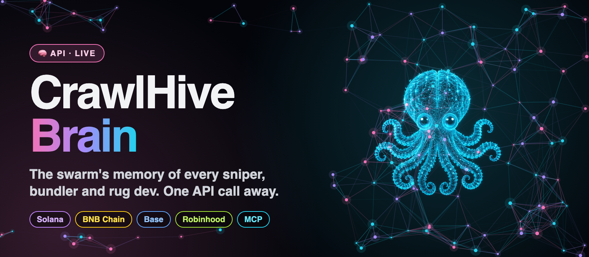
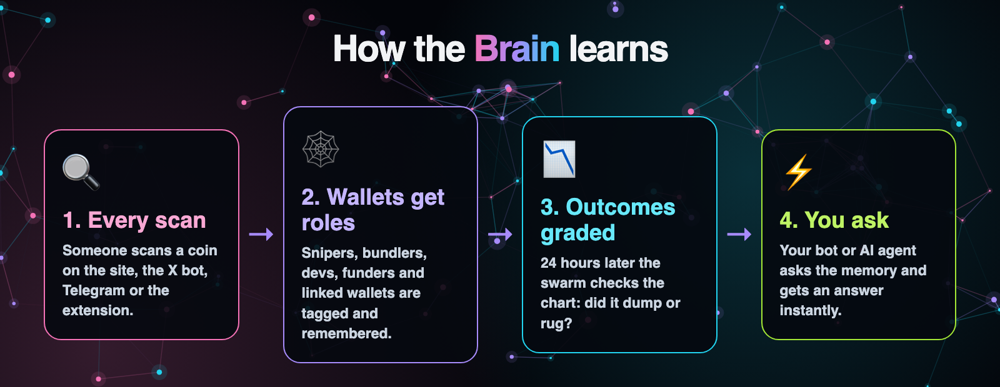
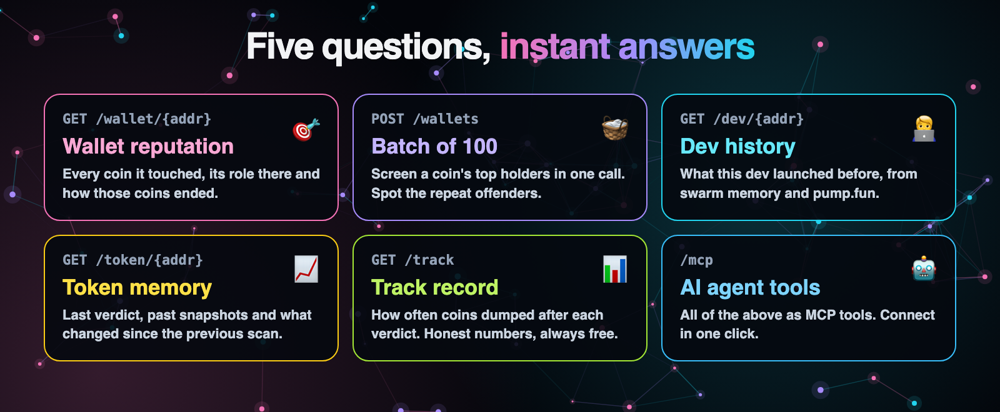
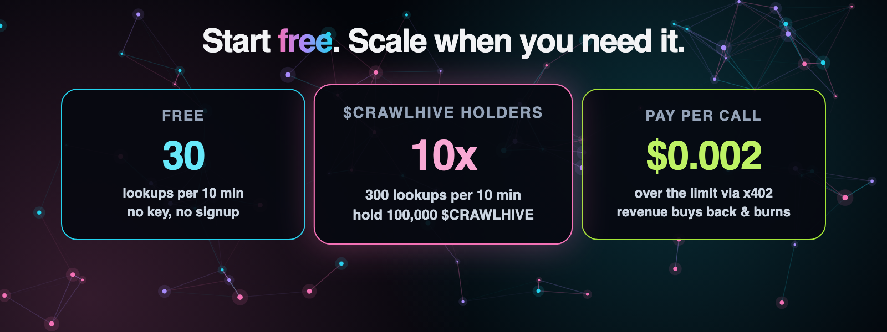

<p align="center">
  
</p>

<p align="center">
  <a href="https://crawlhive.xyz/brain"></a>
  <a href="https://crawlhive.xyz/brain"></a>
  <a href="https://x402.org"></a>
  <a href="https://crawlhive.xyz/mcp"></a>
</p>

<h3 align="center">Know who you're trading against before you ape.</h3>

<p align="center">
  Every memecoin rug leaves fingerprints: the same snipers, the same bundlers, the same devs, coin after coin.<br>
  <b>CrawlHive Brain remembers them</b> and tells your bot, terminal or AI agent in milliseconds.
</p>

<p align="center">
  <a href="https://crawlhive.xyz/brain"><b>Docs</b></a> ·
  <a href="#-quick-start"><b>Quick start</b></a> ·
  <a href="openapi.yaml"><b>OpenAPI</b></a> ·
  <a href="https://crawlhive.xyz"><b>CrawlHive</b></a> ·
  <a href="https://x.com/crawlhivexyz"><b>X</b></a> ·
  <a href="https://t.me/crawlhive"><b>Telegram</b></a>
</p>

---

## 🧠 Why Brain

A safety scan tells you about one coin. Brain tells you about **the people behind it**.

The [CrawlHive](https://crawlhive.xyz) swarm scans memecoins all day on the site, in the X bot, in Telegram and in the browser extension. Every scan leaves something behind: which wallets sniped, bundled, funded or deployed the token, what the verdict was, and what the chart did in the next 24 hours. Brain turns that memory into an API.

- ⚡ **Instant.** Answers come straight from memory. No new scan, no waiting.
- 🌐 **Cross-chain.** Solana, BNB Chain, Base and Robinhood Chain in one place.
- 🔁 **Cross-token.** A sniper from last week's rug is flagged on today's launch.
- 📏 **Honest.** Every answer ships with the baseline, so you can tell signal from noise.
- 🤖 **Agent-native.** The same answers are MCP tools for ChatGPT, Claude and any MCP client.
- 🔥 **Aligned.** Paid calls fund $CRAWLHIVE buybacks and burns.

<p align="center">
  
</p>

## 🕸 How the Brain learns

<p align="center">
  
</p>

1. **Every scan** on any CrawlHive surface feeds the swarm.
2. **Wallets get roles:** sniper, bundle, dev, funder, holder, linked.
3. **Outcomes are graded** 24 hours later: did the coin dump or rug?
4. **You ask** and get the full history in one call.

## 🎯 What it answers

<p align="center">
  
</p>

| Question | Endpoint |
| --- | --- |
| Has this wallet sniped, bundled, funded or deployed other tokens? How did those tokens end? | `GET /wallet/{address}` |
| Which of these 100 wallets have a history? | `POST /wallets` |
| What did this dev launch before, and how did it go? | `GET /dev/{address}` |
| What was the last verdict on this token, and what changed since? | `GET /token/{address}` |
| Which wallets keep working together across coins, and how did their coins end? | `GET /operator/{id}` |
| How often does each verdict actually dump? | `GET /track` |

**Base URL:** `https://crawlhive.xyz/api/brain/v1` · Addresses can be Solana (base58) or EVM (`0x…`, case-insensitive).

## 🚀 Quick start

No key, no signup. Paste this into your terminal:

```bash
curl https://crawlhive.xyz/api/brain/v1/track
```

Screen a coin's top holders in one call:

```bash
curl -X POST https://crawlhive.xyz/api/brain/v1/wallets \
  -H "Content-Type: application/json" \
  -d '{"wallets": ["<wallet 1>", "<wallet 2>", "<up to 100>"]}'
```

From JavaScript:

```js
const res = await fetch(`https://crawlhive.xyz/api/brain/v1/wallet/${address}`);
const brain = await res.json();
if (brain.roles?.sniper && brain.dumpRate > brain.baselineDumpRate) warn("repeat sniper");
```

## 💎 Pricing

<p align="center">
  
</p>

| Tier | Lookups (`/wallet`, `/dev`, `/token`, `/operator`) | Batches (`/wallets`) | `/track` |
| --- | --- | --- | --- |
| Free, per IP | 30 per 10 min | 5 per 10 min | 60 per 10 min |
| Holder of 100,000 $CRAWLHIVE | 300 per 10 min | 50 per 10 min | 600 per 10 min |
| Pay per call (x402) | $0.002 | $0.02 | always free |

- **Holder tier:** send `Authorization: Bearer <key>`, where the key is a CrawlHive bot key (`chb_…`, made on crawlhive.xyz under Grok Bots), an OAuth token (`cht_…`) or a signed-in site session. The wallet behind it must hold the threshold; the balance is read from Solana.
- **Pay per call:** when the free limit runs out, the endpoint answers `402 Payment Required` with [x402](https://x402.org) requirements (USDC on Solana). Any x402 client (for example `@x402/fetch` with `@x402/svm`) signs the transfer and repeats the request with the `PAYMENT-SIGNATURE` header. You pay only when the answer succeeds. No account, no API key.
- **Where the money goes:** Brain revenue is counted with the rest of the x402 revenue that funds $CRAWLHIVE buybacks and burns.
- Every successful response carries `X-Brain-Tier` (`free` or `holder`) and `X-Brain-Limit`.

## 📏 Reading the answers honestly

We'd rather be useful than impressive.

- **Dumped** means the token fell 50% or more below the scan price within 24 hours of the scan. Rugs count as dumped.
- **Most memecoins fall.** In our data roughly 4 in 10 tokens we called CLEAN still dumped within 24 hours, against roughly 8 in 10 we called RISKY. Every answer includes `baselineDumpRate`, the share of all graded tokens that dumped. A wallet whose coins dumped at 100% means more next to a 62% baseline than it does on its own.
- **Memory keeps growing.** Wallet memory lives in a database with no wallet cap, so a sniper from weeks ago is still there. Token snapshots keep the latest 5,000 tokens (10 snapshots each). "Not seen" means the swarm has not met the wallet, not that it is clean.
- **Outcome `untracked`** means the swarm saw the wallet on a token whose price it did not follow.
- **Provable.** Every verdict is committed to Solana every 15 minutes as a Merkle root, so a past verdict can be proven, not just claimed: see `/api/proof` on the main site.

## Examples

The responses below are real, trimmed for length.

### Wallet

```bash
curl https://crawlhive.xyz/api/brain/v1/wallet/5g8bviwgHv6gKzCerSjQbFoYxfHnWawNLLn99HDjpUX3
```

```json
{
  "wallet": "5g8bviwgHv6gKzCerSjQbFoYxfHnWawNLLn99HDjpUX3",
  "seen": true,
  "tokens": 8,
  "chains": ["solana"],
  "roles": { "sniper": 1, "linked": 7 },
  "outcomes": { "settled": 2, "dumped": 2, "rugged": 1, "survived": 0, "open": 1, "untracked": 5 },
  "dumpRate": 1,
  "baselineDumpRate": 0.619,
  "risk": {
    "score": 62,
    "level": "medium",
    "reasons": ["2 of 2 graded coins dumped (baseline 62%)", "Few graded coins, score pulled toward the baseline", "Sniped 1 coin"]
  },
  "operator": null,
  "history": [
    { "token": "goatcZCkcoHEZaBvrmxPtT89yS7gDzcZx1aSrVCcrLu", "chain": "solana", "role": "linked", "symbol": "GOAT", "verdict": "RISKY", "score": 50, "scannedAt": "2026-10-19T22:50:46.855Z", "outcome": "dumped" }
  ],
  "memory": { "wallets": 8000, "cap": null, "tokensPerWallet": null, "store": "sqlite" }
}
```

`operator` is filled when the wallet belongs to one: `{ "id": "op_135334568589", "wallets": 7, "tokens": 3, "dumpRate": 1, "settled": 3 }`.

Roles: `sniper` (bought in the first seconds), `bundle` (bought in the same transaction or block as other wallets), `dev` (created the token), `funder` (funded two or more wallets of the token), `holder` (holds inside a linked operator), `linked` (linked to the operator by transfers).

### Risk score

Every wallet (single or batch) gets `risk`: a score from 0 to 100, a level and the reasons behind it. The formula is simple on purpose:

1. **Dump rate, shrunk toward the baseline.** `p = (dumped + 4 × baseline) / (settled + 4)`. A wallet with 1 of 1 dumped coins looks almost average; one with 9 of 10 does not. Mapped so that the baseline is 0.5 and "every coin dumped" is 1.
2. **Role weight.** The heaviest role the wallet ever had: dev 1.0, funder 0.9, bundle 0.85, sniper 0.6, holder 0.4, linked 0.3.
3. **Operator record.** The same shrunk dump rate for the wallet's operator, 0.5 when it has none.

`score = 100 × (0.6 × dump rate + 0.25 × role + 0.15 × operator)`. **high** is 65 and above, **medium** 50 to 64, **low** under 50. **unknown** (score `null`) when neither the wallet nor its operator has a graded coin yet. It is a reading of past behaviour, not a prediction.

### Operator

```bash
curl https://crawlhive.xyz/api/brain/v1/operator/op_135334568589
```

```json
{
  "id": "op_135334568589",
  "wallets": 7,
  "members": ["2q6uqUs8P3y7sKLK7uezaRtvRSNRBBPh1hshf55CFVhS", "…"],
  "tokens": 3,
  "chains": ["solana"],
  "roles": { "bundle": 12, "funder": 3, "linked": 3 },
  "outcomes": { "settled": 3, "dumped": 3, "rugged": 3, "survived": 0, "open": 0, "untracked": 0 },
  "dumpRate": 1,
  "baselineDumpRate": 0.618,
  "firstSeen": "2026-10-20T21:59:11.378Z",
  "lastSeen": "2026-10-21T06:57:35.011Z",
  "coins": [
    { "token": "8FGreSHZeiinbu3zPeBA3vawxvz2phvyomnPn1NEpump", "symbol": "CLOUT", "verdict": "RISKY", "outcome": "rugged", "at": 1792565855011 }
  ]
}
```

An operator is a set of wallets the swarm saw in the same linked group (shared funder, bundle or dev) on 2 or more different coins. Operators are rebuilt every 10 minutes. The id is stable until two operators merge, so look ids up from fresh wallet answers. Wallets that show up in groups on more than 60 coins (routers, shared services) are left out.

### Batch

```bash
curl -X POST https://crawlhive.xyz/api/brain/v1/wallets \
  -H "Content-Type: application/json" \
  -d '{"wallets": ["5g8bviwgHv6gKzCerSjQbFoYxfHnWawNLLn99HDjpUX3", "0x2bb9562ac9ed6ab531ad5bebd322759fdc4d3969"]}'
```

```json
{
  "checked": 2,
  "seen": 2,
  "baselineDumpRate": 0.619,
  "results": [
    { "wallet": "5g8bviwgHv6gKzCerSjQbFoYxfHnWawNLLn99HDjpUX3", "seen": true, "tokens": 8, "roles": { "sniper": 1, "linked": 7 }, "outcomes": { "settled": 2, "dumped": 2 }, "dumpRate": 1 },
    { "wallet": "0x2bb9562ac9ed6ab531ad5bebd322759fdc4d3969", "seen": true, "tokens": 2, "roles": { "sniper": 2 }, "outcomes": { "settled": 1, "dumped": 1 }, "dumpRate": 1 }
  ]
}
```

Up to 100 wallets per call. Duplicates are merged.

### Dev

```bash
curl https://crawlhive.xyz/api/brain/v1/dev/5S3q74BX8aMDG2s3bzFxQoJur7z5opHtsvB2aHZ7tri9
```

```json
{
  "dev": "5S3q74BX8aMDG2s3bzFxQoJur7z5opHtsvB2aHZ7tri9",
  "seenAsDev": 1,
  "launches": [
    { "token": "3vpvkgxLTMtpff5BjNwfqKmVcpdyTbqihG8gEZAwpump", "chain": "solana", "symbol": "GO", "verdict": "TOO_EARLY", "outcome": "rugged" }
  ],
  "otherRoles": [],
  "pumpfun": { "launched": 2, "graduated": 1, "verdict": "solid", "summary": { "live": 0, "dead": 0, "rugged": 0, "graduated": 1, "bestFdv": null }, "coins": [] },
  "pumpfunError": null,
  "baselineDumpRate": 0.619
}
```

`pumpfun` is filled for Solana wallets only. EVM devs are answered from the swarm's memory.

### Token

```bash
curl https://crawlhive.xyz/api/brain/v1/token/GADj8JQ8iQLQD5S6ScvncJWmGs7PkwHnXsBrEUns6ue5
```

```json
{
  "token": "GADj8JQ8iQLQD5S6ScvncJWmGs7PkwHnXsBrEUns6ue5",
  "chain": "solana",
  "symbol": "POKECOIN",
  "latest": { "verdict": "CLEAN", "score": 81, "reason": "Low liquidity: $19.4k in the pool", "scannedAt": "2026-10-21T13:02:34.454Z" },
  "since": { "prevAt": "2026-10-21T12:26:33.942Z", "changes": [] },
  "snapshots": [
    { "at": "2026-10-21T12:26:33.942Z", "score": 81, "verdict": "CLEAN", "liq": 19418.83, "fdv": 17191, "top10": 76.66, "lp": "locked", "lpPct": 100 }
  ],
  "outcome": { "status": "open", "verdictAtScan": "CLEAN", "scannedAt": "2026-10-21T12:26:33.955Z", "peakPct": 0, "lowPct": 0, "lastPct": 0 },
  "scanUrl": "https://crawlhive.xyz/scan/GADj8JQ8iQLQD5S6ScvncJWmGs7PkwHnXsBrEUns6ue5"
}
```

Tokens the swarm never scanned return `404`. Scan them once at [crawlhive.xyz](https://crawlhive.xyz) and ask again.

### Track record

```bash
curl https://crawlhive.xyz/api/brain/v1/track
```

```json
{
  "windowHours": 24,
  "dumpThresholdPct": -50,
  "tracked": 4000,
  "verdicts": [
    { "verdict": "CLEAN", "tracked": 1592, "settled": 1353, "dumped": 593, "rugged": 231, "medianPeak": 19.3, "dumpRate": 0.438 },
    { "verdict": "OK", "tracked": 437, "settled": 368, "dumped": 154, "rugged": 89, "medianPeak": 0.7, "dumpRate": 0.418 },
    { "verdict": "RISKY", "tracked": 1273, "settled": 1100, "dumped": 864, "rugged": 521, "medianPeak": 12.3, "dumpRate": 0.785 },
    { "verdict": "DANGER", "tracked": 236, "settled": 207, "dumped": 133, "rugged": 72, "medianPeak": 0, "dumpRate": 0.643 },
    { "verdict": "TOO_EARLY", "tracked": 462, "settled": 409, "dumped": 383, "rugged": 326, "medianPeak": -63.1, "dumpRate": 0.936 }
  ],
  "baselineDumpRate": 0.619
}
```

## Errors

Errors are JSON: `{ "error": "message" }`.

| Status | Meaning |
| --- | --- |
| 400 | Not a Solana or EVM address, or a bad batch body |
| 402 | Free limit reached: pay per call with x402 (requirements in the `PAYMENT-REQUIRED` header) |
| 404 | The swarm has no memory of this token or dev yet |
| 429 | Too many calls (paid calls are rate limited per wallet too) |

## For AI agents

The same answers are tools in the CrawlHive MCP server at `https://crawlhive.xyz/mcp`: `brain_wallet`, `brain_wallets`, `brain_dev`, `brain_token`, `brain_operator` and `brain_track`. Connect with a bot key or the OAuth Connect button (ChatGPT, Claude and other MCP clients). The A2A agent at `https://crawlhive.xyz/a2a` understands `wallet <address>`.

## Related APIs

- Full safety scan: `GET https://crawlhive.xyz/api/x402/scan?q=<address or $TICKER>` ($0.01 over x402), or free through the MCP and A2A agents.
- Onchain proof of past verdicts: `GET https://crawlhive.xyz/api/proof?q=<address>`.

## Links

- Site: https://crawlhive.xyz
- Main repo (MIT): https://github.com/h100envy/crawl-hive
- X: https://x.com/crawlhivexyz
- Telegram: https://t.me/crawlhive

Not financial advice.

---

<p align="center">
  <b>Build something that knows the trenches.</b><br>
  <a href="https://crawlhive.xyz/brain">crawlhive.xyz/brain</a>
</p>
